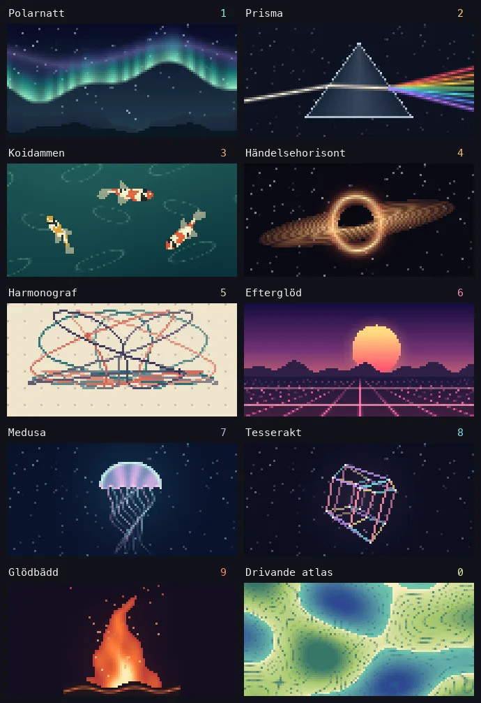
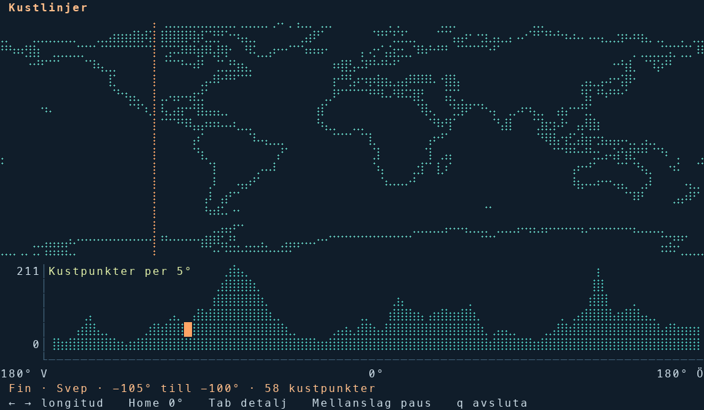

# dunder-tui

Bygg interaktiva terminalappar i Dunder för macOS, Linux och Windows. Skriv en funktion som ritar appens tillstånd och en som tar emot tangenter. Biblioteket sköter inmatning, storleksändringar och återställning av terminalen. Vid omritning skickas bara ändrade celler.

## Prova

Packa upp paketet för din plattform och kör `./motion` eller `.\motion.exe` i en terminal för att öppna animationsgalleriet. Paketet innehåller även `kustlinjer`, `signal`, `bokhylla`, `avganger`, `loggbok`, `almanacka`, `maskot` och `korlista`. [Ladda ner för macOS, Linux eller Windows](https://github.com/Mik-pe/dunder-tui/releases/latest)

På Linux använder den färdigbyggda almanackan systemets glibc (`libc.so.6`) för lokal tid. Övriga åtta Linuxappar i paketet har inga dynamiska biblioteksberoenden.

Bygg från källkod med Dunder 0.11.2. Riktextmodulen använder lånade iteratorresultat som 0.11.0 och 0.11.1 avvisar. På Windows fungerar de färdigbyggda apparna direkt. Dunder 0.11.2 ger ett fel när kompilatorn öppnar ett paketmanifest på Windows, även för ett paket utan beroenden. [Installera Dunder](https://github.com/Mik-pe/dunder#installera-och-kör) · [Windowsprovet](https://github.com/Mik-pe/dunder-tui/actions/runs/45302071651/job/138136790534)

```sh
git clone https://github.com/Mik-pe/dunder-tui.git
cd dunder-tui
dunder run --example counter
```

Tryck ↑ eller ↓ för att ändra talet och `q` för att avsluta. Kör `dunder run --example bokhylla` för att bläddra bland flerradiga bokposter med piltangenterna. Gör fönstret smalare så får boklistan hela bredden.

Lista alla exempel med `dunder --list-examples`. Du kan också ange filen direkt, exempelvis `dunder run examples/motion/main.ddr`.

## Animationer

Kör galleriet med tio animationer. Välj en scen med ← och → eller siffrorna 1–9 och 0. Mellanslag pausar och återupptar. Avsluta med `q`.

```sh
dunder run --example motion
```



Starta en viss scen med exempelvis `dunder run --example motion -- koi`. Lista scenerna med `dunder run --example motion -- --list`.

| Tangent | Scen | Tangent | Scen |
| --- | --- | --- | --- |
| 1 | [Polarnatt](examples/motion/aurora.ddr) | 6 | [Efterglöd](examples/motion/afterglow.ddr) |
| 2 | [Prisma](examples/motion/prism.ddr) | 7 | [Medusa](examples/motion/medusa.ddr) |
| 3 | [Koidammen](examples/motion/koi.ddr) | 8 | [Tesserakt](examples/motion/tesseract.ddr) |
| 4 | [Händelsehorisont](examples/motion/horizon.ddr) | 9 | [Glödbädd](examples/motion/ember.ddr) |
| 5 | [Harmonograf](examples/motion/plotter.ddr) | 0 | [Drivande atlas](examples/motion/atlas.ddr) |

För en egen animation tar `tui.animate(&mut state, 30, draw, update, tick)` hand om bildklockan. `tick` får förfluten tid i millisekunder och returnerar `true` när något behöver ritas. En sen bild går direkt till aktuell tid. Tangentbordet fungerar under tiden. Med `import tui.canvas` kan du rita pixlar och linjer i RGB. `Canvas.render` visar två vertikala pixlar per teckencell. Galleriet använder 24-bitarsfärg i moderna terminaler och närmaste konsolfärg i äldre Windowskonsoler.

### Färgsätt en animation

Prismats sju ljusband hämtar sina RGB-värden från de inbyggda Tailwind- och Materialpaletterna. Använd `color` för en widgetstil eller `rgb` när du ritar direkt på en canvas. Material har även accentnyanser för 16 färgfamiljer. [Prismats färger](examples/motion/prism.ddr)

```dunder
import tui
import tui.tailwind as tailwind
import tui.material as material

fn heading() -> tui.Style {
    tui.ink(tailwind.color(.Violet, .C400))
        .background(material.color(.BlueGray, .C900))
        .underlined().underline_color(material.accent(.Cyan, .A200))
}
```

### Signal

Växla mellan vågform och frekvensspektrum med Tab. Piltangenterna ändrar frekvens och amplitud. Den turkosa mätaren visar signalens effektivvärde. Varje stapel i spektrumet beräknas från samma 128 sampel som vågformen. Mellanslag fryser bilden.

```sh
dunder run --example signal
```

Signalen syntetiseras i appen och kräver ingen ljudenhet. [Källkod](examples/signal/main.ddr)

### Kustlinjer

`dunder run --example kustlinjer` visar en världskarta och ett diagram över antalet kustpunkter per fem längdgrader. Piltangenterna flyttar meridianen, Tab växlar kartans upplösning och mellanslag pausar svepet. [Exemplets källkod](examples/kustlinjer/main.ddr)



### Ratatuis maskot

Kör `dunder run --example maskot` för att se hur en widget kan ritas ovanpå en färgad yta. Mellanslag växlar maskotens ögonfärg och `t` växlar mellan logotyperna på 15 respektive 27 kolumner. Importera `tui.artwork` för att använda samma widgets i en egen app. [Körbart exempel](examples/maskot/main.ddr) · [Grafikens upphov och licens](src/ARTWORK-NOTICES.txt)

### Almanacka

Kör `dunder run --example almanacka` för att öppna aktuell månad. ← och → flyttar en dag, ↑ och ↓ en vecka och hakparenteserna byter månad. Markera ett datum med `m` och gå tillbaka till dagens lokala datum med Home. Prova skottdagen med `dunder run --example almanacka -- 2024 2 29`. [Exemplets källkod](examples/almanacka/main.ddr)

`tui.calendar.Monthly` kan visa angränsande månader, rubriker och datum med egna stilar. Använd `month.events.add(date, style)` för en enstaka markering. Implementera `DateStyler.style_for` och anropa `month.render_with` för regler som helgdagar och veckoslut.

## Skriv en egen app

Skapa ett projekt med `dunder init min-app`. Lägg till beroendet i projektets `dunder.toml`.

```toml
[dependencies]
tui = { git = "https://github.com/Mik-pe/dunder-tui.git", tag = "v0.23.0", capabilities = ["stdio", "unsafe"] }
```

Spara följande i `src/main.ddr` och kör `dunder run` i projektet. Biblioteket använder de beviljade kapabiliteterna för att läsa tangentbordet och styra terminalen.

```dunder
capability stdio
import tui
import sys

fn draw(frame: &mut tui.Frame, count: &i32) {
    frame.label(frame.area(), f"Antal: {count}   ↑ öka   Esc avsluta")
}

fn update(count: &mut i32, key: tui.Key) -> bool {
    match key {
        .Up => { count += 1 },
        .Escape => { return false },
        _ => {},
    }
    true
}

fn main() -> i32 {
    mut count := 0
    match tui.run(&mut count, draw, update) {
        .Ok => 0,
        .Err(message) => { _ := sys.eprint(message); 1 },
    }
}
```

`draw` får en tom bild vid start, efter en tangent och när fönstret byter storlek. Returnera `false` från `update` för att lämna appen. Ctrl+C avslutar också. Om in- eller utmatningen är omdirigerad returnerar `run` ett fel.

En egen widget kan ha metoden `render(&self, frame: &mut tui.Frame, area: tui.Rect)`. Rita den med `frame.render_widget(&widget, area)`. För en widget som uppdaterar sin cache kan du skicka `&mut widget`. Håller appen exempelvis listans markering separat tar `frame.render_stateful_widget(&list, area, &mut selection)` med det tillståndet till `render_stateful`. [Exempel med eget och inbyggt tillstånd](tests/suite.ddr)

## Dela terminalyta med en annan ritare

Sätt en cellregel efter att du ritat innehållet. Med `.Skip` kan exempelvis en bildvisare behålla sina pixlar i terminalen. `.AlwaysUpdate` ritar tillbaka appens tecken även när föregående bild innehöll samma tecken. När en cell återgår till `.None` skriver biblioteket åter dess aktuella innehåll.

```dunder
frame.label(frame.area(),"ABCDE")
_ := frame.set_diff_option(1,0,.Skip)
_ := frame.set_diff_option(2,0,.AlwaysUpdate)
```

`set_cell_with_width(x, y, symbol, columns, style)` låter en widget skriva en egen teckenföljd och ange antalet kolumner den tar i anspråk. `cell_at` läser tecken, stil och cellregel tillsammans. Med `frame.merge(&overlay)?` kan du kombinera två buffertar med olika origo. Överlappande celler hämtas från `overlay`, även tomma celler. [Exempel och terminalprov](tests/buffer_terminal.ddr) · [Jämförelse mot Ratatui](docs/parity.md#bildbuffert-och-celldiff-i-0130)

## Markör och testterminal

Anropa `frame.set_cursor_position(x,y)` där markören ska synas. Det sista anropet i en bild bestämmer positionen. I nästa bild är markören dold tills ritfunktionen begär den igen. `frame.count()` börjar på noll och räknar visade bilder. I `bokhylla` öppnar **e** den valda bokens anteckning för redigering. Piltangenterna flyttar markören ett grafem i taget, Enter behåller texten i sessionen och Esc återgår till boken. [Redigeraren](examples/bokhylla/editor.ddr)

Samma ritfunktion går att prova utan en ansluten terminal.

```dunder
import tui
import tui.testing as testing

fn draw(frame: &mut tui.Frame, text: &mut string) {
    frame.label(frame.area(),text)
    frame.set_cursor_position(2,0)
}

fn main() {
    mut terminal := tui.Terminal<testing.TestBackend>::new(testing.TestBackend::new(8,2))
    mut text := "Hej"
    assert(terminal.draw(&mut text,draw).is_ok())
    assert(terminal.backend().buffer().line(0) == "Hej     ")
    assert(terminal.backend().cursor_visible())
    assert(terminal.backend().cursor_position() == (2,0))
}
```

Implementera `tui.Backend` med `size` och `present` för att ansluta en egen utmatning. `present` får aktuell och föregående bild. `frame.ansi_diff(&previous,&mut output)` skriver ändrade celler och markörkommandon till en bytebuffert. Med `try_draw` kan ritfunktionen returnera ett fel före utmatningen. Om backenden rapporterar ett skrivfel får den en hel bild nästa gång. `completed()` ger den senast lyckade bilden. Anropa `invalidate()` för att tvinga fram en hel omritning efter externa ändringar. [Backend med felprov](tests/suite.ddr) · [Testterminalens skrollhistorik](src/testing.ddr)

### Rita i separata steg

Använd `terminal.draw(...)` för den vanliga ritloopen. En egen händelseloop kan förbereda flera widgets i samma arbetsbuffert och välja när de ska visas.

```dunder
frame := terminal.get_frame()
frame.label(frame.area(),"Nästa avgång")
terminal.flush()?
terminal.swap_buffers()
terminal.backend_mut().flush()?
```

`terminal.flush()` skickar ändrade celler till backenden. `swap_buffers()` väljer den färdigritade bilden som grund för nästa diff och ger dig en tom arbetsbuffert. Ett separat `backend_mut().flush()` tömmer en eventuell utmatningsbuffert. Bildräknaren fortsätter på samma nummer genom dessa tre steg.

Om du vill göra allt i ett anrop efter att ha fyllt arbetsbufferten, använd `apply_buffer()?` för dold markör eller `apply_buffer_with_cursor(.Some((x,y)))?` för synlig markör. Båda räknar en visad bild. [Körbart terminalexempel](tests/manual_app.ddr)

### Styr markören mellan bilder

Med en öppen `Terminal` kan du läsa och flytta den verkliga markören även utanför ritfunktionen. Koordinaterna börjar på noll och gäller hela terminalen. Förflyttning behåller markörens synlighet.

```dunder
(x,y) := terminal.cursor_position()?
terminal.hide_cursor()?
terminal.set_cursor_position(x,y+1)?
terminal.show_cursor()?
```

Vid nästa lyckade ritning bestämmer bildens markör åter position och synlighet. En misslyckad ritfunktion behåller den visade bilden och `completed()`. De celler funktionen redan skrivit finns kvar i arbetsbufferten. Anropa `current_buffer_mut().clear()` om du vill börja om på en tom bild. Egna backends kan implementera `read_cursor`, `move_to` och `set_cursor_visible`. Metoderna returnerar ett fel om backenden saknar stödet. [Körbart exempel](tests/direct_cursor_app.ddr)

När en `Terminal` lämnar sitt scope efter att ha dolt markören anropar den backendens `restore_cursor()`. En egen backend som implementerar `set_cursor_visible` får återställningen automatiskt. Win32-backenden återställer konsolens sparade markörstorlek och synlighet. [Prov med tidig retur och ägarbyte](tests/cursor_lifetime.ddr)

## Rita i en del av terminalen

`terminal.size()` ger hela backendens kolumner och rader. Använd `frame.area()` för ytan du får rita i. Om terminalen ändrar storlek mellan två bilder kan du anropa `terminal.autoresize()?` och sedan läsa `viewport_area()`. En fast vy behåller sitt läge och sina mått.

För grafik kan `terminal.window_size()` även ge `pixel_width` och `pixel_height`. På macOS och Linux går det att fråga med `tui.window_size()` redan före första bilden. En terminal kan lämna noll i ett eller båda pixelmåtten. Windowsbackenden returnerar ett fel för pixelfrågan. Kolumn- och radmått finns via `terminal.size()` på alla tre systemen.

Kör `dunder run --example loggbok`. Appen visar två rader under skalets tidigare utmatning. Enter lägger en händelse ovanför vyn. När terminalen är full hamnar de äldsta raderna i skrollhistoriken. Tryck **q** för att fortsätta i skalet under loggboken. [Hela exemplet](examples/loggbok/main.ddr)

Använd `tui.run_in(.Fixed(area), &mut state, draw, update)` för en interaktiv vy på en bestämd plats. `frame.area()` ger terminalens absoluta koordinater. Text, widgets, cellkopior och markören använder samma koordinater. För en inbäddad vy med egen händelseloop öppnar du terminalen med `tui.open(.Inline(2))?`. Skicka en `Frame` med vyportens bredd till `term.insert_before(&lines)` när du vill lägga till färgsatta loggrader. Terminalen återställer sitt läge när den går ur räckvidd.

## Bygg en vy

| Anrop | Användning |
| --- | --- |
| `frame.area()` | Hela ritytan i terminalkolumner och rader. |
| `area.rows(n)`, `area.cols(n)` | Dela av de första `n` raderna eller kolumnerna. Båda delarna returneras och ryms i ytan. |
| `area.inset(n)` | Lämna en marginal innanför ytan. |
| `frame.panel(area, title, style)` | Rita en ram och få tillbaka innerytan för innehållet. |
| `frame.label(area, text)`, `frame.text(area, text, style)` | Visa text med radbrytningar. Långa rader klipps vid kanten. |
| `frame.list(area, &items, selected, highlight)` | Visa listan med markerad rad. När markeringen passerar nederkanten följer vyn med. |
| `tui.ink(.Cyan).bold()` | Välj textfärg. `.background(.Blue)` och `.inverted()` kan kombineras med färg och fetstil. |

En egen widget är en vanlig funktion som tar `&mut tui.Frame` och en `tui.Rect`. Använd `tui.ink(tui.rgb(0x82efc5))` för RGB eller `tui.ink(.Indexed(197))` för palettfärg. Testa den utan terminal med `tui.Frame::new(20, 4)` och läs en färdig rad med `frame.line(0)`. [Körbara exempel på layout och textklippning](tests/suite.ddr)

### Responsiv layout

En sidomeny kan ta 18 kolumner och lämna resten till innehållet. Spara layouten i appens tillstånd så att den kan återanvända beräkningen mellan bilder.

```dunder
import tui.layout as layout

mut columns := layout.Layout::horizontal([.Length(18), .Fill(1)]).spacing(1)
panes := columns.split(frame.area())
frame.label(panes[0], "Bibliotek")
frame.label(panes[1], "Mina böcker")
```

`vertical` delar på höjden. Använd `Percentage(40)`, `Ratio(1,3)`, `Min(8)` eller `Max(24)` för andra storleksregler. `flex(.Center)` centrerar en grupp och `margin(2,1)` lämnar två kolumner och en rad runt den. Negativt mellanrum låter paneler överlappa. För tät omritning ger `columns.arrange(area).regions()` en lånad vy med både paneler och mellanrum. [Bokhyllans responsiva vy](examples/bokhylla/main.ddr) · [Jämförelse med Ratatui](docs/parity.md#layout-i-070)

## Mätare, diagram och paneler

Med `import tui.widgets as ui` kan du rita en mätare i valfri del av en bild.

```dunder
mut level := ui.Gauge::percent(37)
level.fractional = true
level.bar_style = tui.plain().foreground_rgb(0x8dffdb).background_rgb(0x23354b)
level.render(&mut frame, area)
```

| Modul | Byggstenar |
| --- | --- |
| `tui.widgets` | `Gauge`, `LineGauge`, `Sparkline`, `Tabs` och `Scrollbar` med eget skrolltillstånd. |
| `tui.barchart` | Horisontella och vertikala staplar med grupper, etiketter och färger per stapel. |
| `tui.block` | Ramar med egna kanttecken, flera titlar, marginal innanför kanten och skuggor. Delade kanter kan slås ihop. |

`area.take_rows(n)` tar ut de första raderna och låter `area` fortsätta direkt under dem. `take_cols(n)` gör motsvarande för kolumner. Använd `frame.fill_symbol(area, "🌊", style)` för att upprepa hela grafem eller `frame.clear_area(area)` för att tömma ytan före en överlagring. [Exempel med flikar, paneler och diagram](examples/signal/main.ddr)

Med `import tui.widgets` får du även `Fill` och `Clear` som vanliga widgets. `Fill` lagrar samma sträng i varje cell och lägger sin stil ovanpå cellens befintliga stil. Det fungerar även för en tom sträng och för en symbol som upptar flera kolumner. `Clear` återställer symbol, stil och diffregel i rutan. Du kan spara en `Fill` i appens tillstånd och ändra färg eller symbol mellan bilder.

```dunder
mut paper := widgets.Fill::new("·")
paper.style = tui.ink(.Cyan)
frame.render_widget(&paper, area)
frame.render_widget(widgets.Clear{}, dialog)
```

## Rita i egna koordinater

Med `tui.plot` kan du ge ritytan egna x- och y-gränser. Lägg flera former i ett lager med `point`, `line`, `filled_line`, `rectangle`, `circle` och `map`. Anropa `layer()` för att lägga nästa form ovanpå. Det finns nio markörtyper, bland annat braille, halvblock med två färger och egna tecken.

```dunder
import tui.plot as plot

mut view := plot.Plot::new([-10.0,10.0],[-5.0,5.0])
p := view.begin(&mut frame,area)
p.line(-12.0,-3.0,12.0,3.0,.Cyan)
p.set_marker(.HalfBlock)
p.circle(0.0,0.0,3.0,.Yellow)
view.finish(&mut frame)
```

För en kurva kan du skicka hela följden av koordinatpar till `p.polyline(&points,.Cyan)`. Använd `p.filled_polyline(&points,0.0,.Blue)` för att fylla ned till y = 0. En ensam punkt syns också. Om du vill lägga en widget mellan två grupper av former kan du skriva den första gruppen med `p.finish(&mut frame)`, rita widgeten och sedan fortsätta med samma koordinatsystem.

Med `tui.chart` delar flera dataserier samma axlar. Varje serie kan ritas som punkter, linje, staplar eller fylld yta. För en interaktiv app kan du spara diagrammet i tillståndet och ändra `graph.datasets[0].data` eller axelgränserna före nästa ritning.

```dunder
import tui
import tui.chart as chart
import tui.text as rich

mut samples := chart.Dataset::new([(0.0,1.0),(1.0,3.0),(2.0,2.0)])
samples.graph_type = .Line
samples.marker = .Braille
samples.style = tui.ink(.Cyan)
mut graph := chart.Chart::new([move samples])
graph.x_axis = chart.Axis::new([0.0,2.0])
graph.y_axis = chart.Axis::new([0.0,4.0])
graph.y_axis.labels = [rich.Line::raw("0"),rich.Line::raw("4")]
graph.render(&mut frame,area)
```

`tui.animate_stateful` låter ritfunktionen ta `&mut S` så att diagram och ritytor kan återanvända sina buffertar mellan bilder. [Kustkartans båda vyer](examples/kustlinjer/main.ddr) · [Jämförelse med Ratatui](docs/parity.md#diagram-och-canvas-i-090)

## Listor med markering

Spara listan och dess skrolltillstånd i din app. En post kan innehålla flera rader, färgade textspann och breda tecken.

```dunder
import tui
import tui.list as lists
import tui.text as rich

mut books := lists.List::new([lists.Item::raw("Nattåget\nRoman"), lists.Item::raw("Molnatlas\nNatur")])
books.marker = rich.Line::raw("▸ ")
books.highlight = tui.plain().background_rgb(0x224451)
books.scroll_padding = 1
mut cursor := lists.ListState::new()
cursor.first()
```

Rita med `books.render_stateful(&mut frame, area, &mut cursor)`. Anropa `cursor.next()` och `cursor.previous()` från tangenthanteraren. När vyn krymper justerar listan `cursor.offset` så att hela den markerade posten syns om den ryms. `cursor.last()` hittar sista posten vid nästa ritning, även om innehållet har bytts med `books.set_items(...)`. En lista från nederkanten använder `books.direction = .BottomToTop`. [Bokhyllans källkod](examples/bokhylla/main.ddr) · [Mätning med 16 384 poster](benchmarks/lists.md)

## Tabeller

Kör `dunder run --example avganger` för en tidtabell med flerradiga avgångar. Piltangenterna byter rad eller kolumn. Home och End hoppar till första eller sista avgången. [Exemplets källkod](examples/avganger/main.ddr)

```dunder
import tui.table as table

mut departures := table.Table::new([table.Row::strings(["19:42","Malmö C"]),
    table.Row::strings(["20:08","Åre"])],[.Length(7),.Fill(1)])
departures.header = .Some(table.Row::strings(["Tid","Destination"]))
departures.cell_highlight = tui.plain().background_rgb(0x25384c).bold()
mut cursor := table.TableState::new()
cursor.select_cell(.Some((0,1)))
```

Spara tabell och markering i appens tillstånd. Rita med `departures.render_stateful(&mut frame, area, &mut cursor)`. En `Cell` kan innehålla rik text och spänna över flera kolumner. Ange `row.height` för flerradigt innehåll. Ändra en befintlig cell med `set_cell` och ersätt hela datamängden med `set_rows`. [Tabellprov](docs/parity.md#tabeller-i-080)

## Rik text och radbrytning

Med `import tui.text as rich` kan en rad blanda färger, attribut och breda tecken. Det här stycket kan sparas i appens tillstånd och ritas med `artikel.render(&mut frame, area)`.

```dunder
artikel := rich.Paragraph::new(rich.Text::new([
    rich.Line::raw("Nattjournal").align(.Center),
    rich.Line::new([
        rich.Span::styled("18.00  ", tui.ink(.LightCyan).bold()),
        rich.Span::raw("Koi simmar under bron. 🌙"),
    ]),
])).wrap(.Trim)
```

`.Trim` radbryter vid ord och tar bort inledande blanksteg. `.Preserve` behåller indrag och `.Clip` klipper långa rader. `set_scroll(rad, kolumn)` flyttar läspositionen. Horisontell skrollning gäller vänsterjusterad, klippt text. För en lång text som skrollas ofta kan `artikel.prepare(bredd)` beräkna radbrytningarna en gång. Den förberedda texten har `height()`, `set_top(rad)` och `resize(bredd)`.

Kör `dunder run examples/reader/main.ddr` för att prova en läsare. Piltangenterna skrollar, Home och End hoppar mellan början och slutet. Läsaren använder `tui.run_stateful` så att ritfunktionen kan anpassa skrollpositionen till fönstrets storlek. [Läsarens källkod](examples/reader/main.ddr)

Vid ord­brytning flyttar `.wide_wrap(.NextLine)` ett brett tecken till nästa rad när bara en kolumn återstår. Det är standardvalet. Välj `.wide_wrap(.Overhang)` för Ratatuis radbrytning, där tecknet får börja i styckets sista kolumn. Båda lägena fungerar med `prepare`.

För text som ändras under körning kan du lägga till rader, byta ut ett enskilt spanns innehåll och låta färgen följa med. `width()` mäter det aktuella innehållet i terminalkolumner.

```dunder
mut journal := rich.Text::new([])
journal.push_span(rich.Span::styled("Väntar", tui.ink(.Cyan)))
journal.push_line(rich.Line::raw("Kaj 4"))
journal.line_mut(0).span_mut(0).set_content("Framme")
journal.append(rich.Text::raw("Kaj 5\nKaj 6"))
```

`lines()` och `spans()` lånar innehållet för läsning. `span.content()` ger den ursprungliga UTF-8-texten. `journal.to_string()` skriver en rad per `Line`. Radslut inne i ett spann utelämnas vid utskrift.

Kör `dunder run --example korlista` för att redigera ett scenprogram. Välj rad med piltangenterna, flytta den med `k` eller `j`, bocka av med mellanslag och växla mellan dag- och kvällspasset med Tab. Exemplet använder `lines_mut().swap(a, b)` för att flytta en rad med alla dess stilar. `replace_lines(move nästa)` byter ut hela programmet och lämnar tillbaka de gamla raderna. På en enskild rad gör `spans_mut()` och `replace_spans` motsvarande sak. [Körlistans källkod](examples/korlista/main.ddr)

`append(move nästa)` flyttar över raderna med deras egna stilar. Det mottagande dokumentets stil och justering gäller för hela texten. Med `styled_graphemes` kan du läsa precis den symbol och stil som varje spann bidrar med.

```dunder
for glyph in journal.lines()[0].styled_graphemes(journal.get_style()) {
    print(glyph.symbol())
}
```

Vid tät upprepad läsning kan `visit_graphemes` skicka symbolen och stilen direkt till en funktion. Funktionen får ett eget muterbart tillstånd, en lånad `&str` och en lånad `&tui.Style`. Returnera `false` för att stanna vid aktuell symbol. [Körbart exempel med båda lässätten](benchmarks/graphemes.ddr)

## Stilar som kan kombineras

Lägg bakgrunden en gång och låt varje text välja sina attribut. En färg eller ett attribut som inte anges ärvs från cellen. `Style::reset()` återställer samtliga fält till terminalens grundstil.

```dunder
frame.apply_style(frame.area(), tui.plain().background(tui.rgb(0x1c162d)))
rubrik := tui.ink(.LightCyan).bold().underlined().underline_color(.Indexed(199))
frame.text(frame.area(), "Polarnatt", rubrik)
```

Använd `base.patch(overlay)` för att kombinera två stilar, `.without(.Bold)` för att ta bort ett attribut och `frame.style_at(x, y)` för att läsa resultatet i ett test. För färgteman finns `tui.Color::parse("#a875ff")`, `Color::from_hsl(h, s, l)` och `Color::from_hsluv(h, s, l)`. Understrykningsfärg, kursiv och blinkning visas när terminalen stöder dem.

För animerade färger tar `foreground_rgb(0x54dcbe)`, `background_rgb(...)` och `underline_index(199)` färgdata direkt. Det undviker temporära färgvärden i ritloopen.

I 0.3 används `tui.plain()` och stilmetoderna för att ersätta gamla `Style { ... }`-literaler. `.White` behåller färg 7, även kallad `.Gray`. `.BrightWhite` är färg 15. Ett palettindex kan skiljas från en namngiven färg i `style_at`.

## Plattformar och tester

| Mål | Terminal |
| --- | --- |
| `arm64-macos` | Interaktiv TTY med stöd för ANSI och alternativ skärm. |
| `arm64-linux`, `x86_64-linux` | Samma terminalgränssnitt. Appen använder Linux systemanrop direkt. |
| `x86_64-windows` | Win32-konsol med egen skärmbuffert och tangentbordshändelser via `ReadConsoleInputW`. |

Kör `dunder test examples/motion/tests.ddr` för alla tio animationerna och `dunder test` för layout, rullning, Unicode och tangentavkodning. På macOS och Linux öppnar `dunder run tests/posix_terminal.ddr` en pseudoterminal och kontrollerar bland annat omritning, storleksändring, Ctrl+C och återställning. Windowsprovet öppnar en separat konsol och kontrollerar inmatning, skärminnehåll, färg och återgång till föregående skärm. Det kan korsbyggas med `dunder build tests/windows_console.ddr --target x86_64-windows -o console.exe` och köras med `.\console.exe` på Windows. [Bygg direkt på Windows med 0.11.2](.github/workflows/native.yml)

I en pseudoterminal på en Mac med M5 skickade de tio scenerna 29,9–30,1 bilder per sekund vid 100 × 30 teckenceller och ett mål på 30. Galleriets scenbyte, paus och återställning av terminalen har provats på macOS och Linux. Windowsbinären har provats under Wine. Det separata Win32-provet har även körts på Windows Server 2025 x64 där det läser tillbaka celler, färger och markör från konsolen. [Win32-körning](https://github.com/Mik-pe/dunder-tui/actions/runs/45302071651/job/138136790534) · [Renderingsmätning mot Ratatui](benchmarks/README.md) · [Täckning och återstående arbete](docs/parity.md)

Korsbygg exempelvis en Windowsapp med `dunder build examples/counter/main.ddr --target x86_64-windows -o counter.exe`.

Text delas vid grafemgränserna i Unicode 17.0. För enskilda teckens cellbredd används Unicode 18.0 med Ratatuis terminalanpassningar. Emoji, kombinerande tecken och flaggor hålls ihop vid radbrytning och klippning. Terminalens typsnitt och Unicode-stöd påverkar hur de visas. [Unicode 17](https://www.unicode.org/Public/17.0.0/ucd/) · [Unicode 18](https://www.unicode.org/Public/18.0.0/ucd/) · [Licens för tabellerna](src/UNICODE-LICENSE.txt)

Biblioteket, exemplen och terminalproven byggs med Dunder 0.11.2. [Reproducerade språk- och standardbiblioteksfynd](docs/dunder.md)
